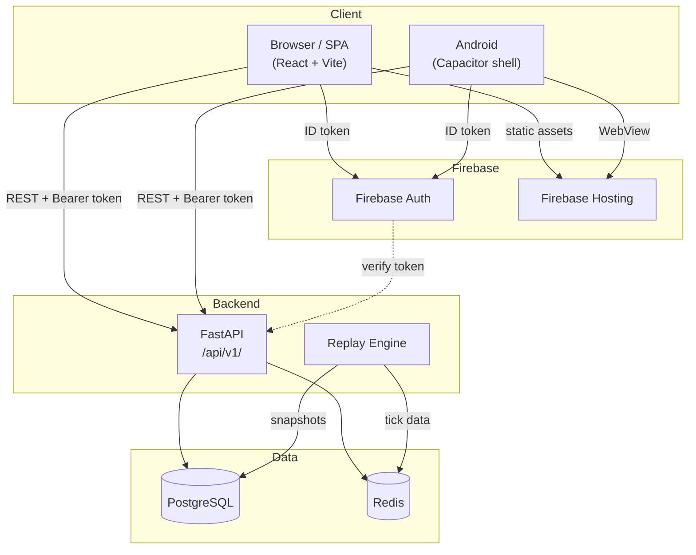

# Architecture — Naytra

> Educational paper-trading app for BSE Sensex 30

---

## 1. System Overview

Naytra is a single-page web application backed by a Python API server. It teaches stock-market concepts through simulated trading on the BSE Sensex 30 universe — no real money is involved.

| Layer | Technology | Role |
| --- | --- | --- |
| **Frontend** | React 18 SPA (Vite) | UI, charts, paper-trading interactions |
| **Backend** | FastAPI (Python 3.11+) | Business logic, REST API, replay engine |
| **Database** | PostgreSQL 16 | Persistent storage — users, ledger, orders |
| **Cache / Pub-Sub** | Redis 7 | Session cache, rate limiting, replay ticker |
| **Identity** | Firebase Auth | Email/password + Google sign-in |
| **Hosting (web)** | Firebase Hosting | Static SPA delivery |
| **Mobile shell** | Capacitor (Android) | Thin native wrapper around the SPA |

---

## 2. Architecture Diagram



---

## 3. Data Flow

### 3.1 Request Lifecycle

1. User interacts with the React SPA in the browser (or Capacitor WebView).
2. The SPA obtains a Firebase ID token from Firebase Auth.
3. Each API call includes the token as `Authorization: Bearer <token>`.
4. FastAPI middleware verifies the token with Firebase Admin SDK.
5. The handler executes business logic, reading/writing PostgreSQL and Redis.
6. A JSON response envelope (`{ ok, data, error }`) is returned to the SPA.

### 3.2 Replay / Market Data Flow

1. The **Replay Engine** reads historical tick data (source TBD — see `OPEN_QUESTIONS.md` Q2).
2. Ticks are published to a Redis channel.
3. The API streams ticks to connected clients via Server-Sent Events or polling.
4. Snapshots are periodically persisted to PostgreSQL for analytics.

---

## 4. Key Architectural Decisions

### 4.1 Integer Paise for Money

All monetary values are stored and transmitted as **integer paise** (1 INR = 100 paise). This eliminates floating-point rounding errors that plague financial calculations.

```
display_inr = paise / 100
```

The frontend formats paise into the user-visible `₹ X,XX,XXX.XX` string; the API and database never store rupee floats.

### 4.2 Double-Entry Ledger

Every financial event (signup bonus credit, stock purchase, stock sale, brokerage deduction) produces **two ledger rows** that sum to zero. This guarantees:

- The total system balance is always zero.
- Every rupee (paisa) is traceable.
- Auditing is trivial: `SELECT SUM(amount_paise) FROM ledger` must equal `0`.

### 4.3 DATA_MODE

The replay engine operates in one of three modes, controlled by the `DATA_MODE` environment variable:

| Mode | Description | Use case |
| --- | --- | --- |
| `REPLAY` | Plays back historical tick data at configurable speed | Default educational mode |
| `DEMO` | Synthetic random-walk generator, no external data needed | Development / demos |
| `LIVE` | Reserved for future real-time data (requires licensing) | Phase 2+ |

---

## 5. Directory Structure

```
Naytra/
├── web/                 # React SPA (Vite)
│   ├── public/
│   ├── src/
│   │   ├── components/
│   │   ├── pages/
│   │   ├── hooks/
│   │   ├── lib/
│   │   └── styles/
│   ├── index.html
│   ├── vite.config.ts
│   └── package.json
│
├── api/                 # FastAPI backend
│   ├── app/
│   │   ├── routers/
│   │   ├── models/
│   │   ├── services/
│   │   ├── middleware/
│   │   └── main.py
│   ├── tests/
│   ├── alembic/
│   ├── requirements.txt
│   └── pyproject.toml
│
├── android/             # Capacitor Android project
│   └── app/
│       └── google-services.json   ← git-ignored
│
├── docs/                # This documentation
│   ├── ARCHITECTURE.md
│   ├── SETUP.md
│   ├── API.md
│   ├── SECURITY.md
│   ├── DESIGN.md
│   ├── COSTS_AND_SERVICES.md
│   ├── OPEN_QUESTIONS.md
│   ├── ROADMAP.md
│   ├── REQUIREMENTS_DELTA.md
│   ├── THIRD_PARTY.md
│   └── UI_QA.md
│
├── docker-compose.yml
├── .env.example
└── README.md
```

---

## 6. Technology Choices and Rationale

| Choice | Why |
| --- | --- |
| **React 18** | Industry-standard UI library; large ecosystem, strong hiring pool, excellent dev tooling. |
| **Vite** | Fastest DX for React; ESM-native, sub-second HMR. |
| **Tailwind CSS** | Utility-first CSS avoids class-name proliferation and keeps bundle small with purging. |
| **TanStack Query** | Declarative server-state management with caching, retries, and stale-while-revalidate — reduces boilerplate vs raw `useEffect`. |
| **React Router** | De-facto SPA routing; supports code-splitting and lazy routes. |
| **FastAPI** | Async Python with auto-generated OpenAPI docs; type-safe with Pydantic. |
| **SQLAlchemy 2.0** | Mature ORM; parameterized queries by default; Alembic migrations. |
| **PostgreSQL** | ACID-compliant, JSON support, excellent for financial ledger patterns. |
| **Redis** | Sub-millisecond reads for rate limiting, session cache, and pub-sub tick streaming. |
| **Firebase Auth** | Free tier covers our scale; handles email/password + Google OAuth without custom auth infrastructure. |
| **Firebase Hosting** | Free static hosting with global CDN; pairs with Firebase Auth for easy token refresh. |
| **Capacitor** | Wraps the SPA into a native Android shell without rewriting the UI. |
| **Bricolage Grotesque / IBM Plex Sans** | OFL-licensed, self-hosted to avoid external network requests and ensure brand consistency. |

---

## 7. Cross-Cutting Concerns

| Concern | Approach |
| --- | --- |
| **Authentication** | Firebase ID tokens verified server-side on every request |
| **Authorization** | User-scoped queries; no user can see another user's data |
| **Validation** | Pydantic models on input; Zod (or similar) on the frontend |
| **Error handling** | Structured envelope `{ ok, data, error }` with machine-readable error codes |
| **Logging** | Structured JSON logs (Python `structlog`) |
| **Testing** | pytest (API), Vitest + React Testing Library (web) |
| **CI/CD** | GitHub Actions (planned) |
| **Security headers** | Strict CSP, HSTS, X-Frame-Options — see `SECURITY.md` |

---

*Last updated: 2026-11-14*
