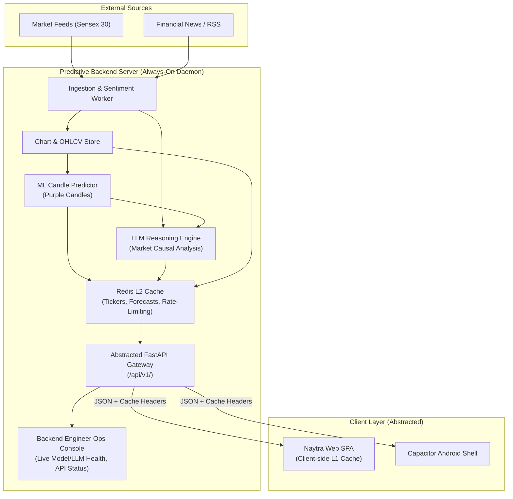

# Architecture — Naytra

> Educational paper-trading platform for BSE Sensex 30 with ML Candle Forecasting & LLM Reasoning

---

## 1. System Overview

Naytra is built as an abstracted two-tier ecosystem:
1. **Predictive Market Server (Backend-Only Engine)**: Ingests market data and sentiment feeds, runs ML candle forecasting and LLM reasoning models, maintains chart stores, and exposes an abstracted high-performance API.
2. **Client Layer (Main Naytra App)**: Consumes the abstracted market, wallet, and prediction data with local and edge caching, providing a zero-risk educational trading experience for BSE Sensex 30 stocks.

| Layer | Technology | Role |
| --- | --- | --- |
| **Client App** | React 18 SPA (Vite, TypeScript, Tailwind) | Educational simulator UI, charts, paper-trading, client cache |
| **Backend Engine** | FastAPI (Python 3.11+ / Uvicorn) | Business logic, market ingestion, ML inference, LLM reasoning |
| **Ops Console** | Lightweight React / HTML5 Admin View | Real-time monitoring of models, LLM latency, API keys, and charts |
| **Forecasting Engine** | ML Time Series Model + Gemini LLM | Projects remaining purple candles for today + explains market rationale |
| **Cache & Pub/Sub** | Redis 7 | Live tickers, quote caching, sliding-window rate limiting |
| **Database** | Cloud Firestore + PostgreSQL/Timescale | User profiles, wallets, immutable double-entry ledger, historical OHLCV |
| **Identity** | Firebase Auth | Native Google OAuth + verified email/password |
| **Mobile Shell** | Capacitor 8 | Native Android wrapper around the client SPA |

---

## 2. Architecture Diagram

---

## 3. Data & Prediction Lifecycle

### 3.1 Candlestick Color Convention
- **Actual Historical & Real-Time Candles**:
  - Green: Bullish ($Close \ge Open$)
  - Red: Bearish ($Close < Open$)
- **Forecast Candles (Rest of Today)**:
  - **Purple (`#8A2BE2`)**: Predicted future candles projected by the ML model for the remainder of today's market session.
  - **Dynamic Replacement**: As time advances and new real market data arrives, each purple candle is replaced by the real green or red candle.

### 3.2 LLM Reasoning
- For every forecasted stock, the LLM evaluates the confluence of news sentiment, price momentum, and support/resistance levels.
- It outputs a structured insight containing: summary rationale, primary catalyst, risk level, and a confidence rating ($0-100\%$).

### 3.3 Backend Engineer Ops Console
A standalone dashboard for site reliability and backend engineers to monitor:
1. **Model Health**: Active model checkpoint, inference latency (ms), prediction drift.
2. **LLM Health**: Response time, token usage, API quota percentage, error rate.
3. **API Key Health**: Status of market feed keys, news sources, Gemini keys (Active / Degraded / Rate-limited).
4. **Cache Health**: Redis hit/miss ratio, memory footprint, active tickers.
5. **Chart Preview**: Live chart rendering actual (green/red) + purple forecast candles.

---

## 4. System Design & Abstraction Principles

1. **Information Hiding**: The main client application has no visibility into internal model weights, raw prompt templates, or ingestion workers. It only requests `/api/v1/market/charts/{symbol}` and receives tagged candle objects (`is_forecast: true/false`).
2. **Two-Tier Caching**:
   - **L1 Client Cache**: Client apps cache historical and forecast candles in memory/IndexedDB using `stale-while-revalidate` (SWR) patterns.
   - **L2 Redis Cache**: The backend serves read requests directly from Redis, preventing database or model re-computation on every client hit.
3. **Integer Currency Arithmetic**: All cash balances, stock prices, and brokerage fees are handled in **integer paise** ($1\text{ INR} = 100\text{ paise}$).
