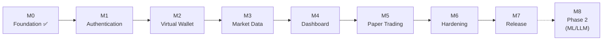

# Roadmap — Naytra

---

## Milestone Overview

---

## M0: Foundation ✅

> **Status: Complete**

| Deliverable | Status |
| --- | --- |
| React SPA scaffolding (Vite + TypeScript) | ✅ |
| FastAPI project scaffolding | ✅ |
| Docker Compose for PostgreSQL + Redis | ✅ |
| Health, readiness, and meta endpoints | ✅ |
| Project documentation suite | ✅ |
| Brand reference and design tokens defined | ✅ |
| Directory structure established | ✅ |

---

## M1: Authentication

> **Status: Not started**

| Deliverable | Details |
| --- | --- |
| Firebase Auth integration (web) | Email/password + Google sign-in |
| Sign-up page | Form with validation, brand styling |
| Sign-in page | Form with validation, brand styling |
| Auth context / provider (React) | `useAuth()` hook, protected routes |
| API auth middleware | Verify Firebase ID tokens server-side |
| User record in PostgreSQL | Sync Firebase UID → local user table on first login |
| Logout flow | Clear tokens, redirect to sign-in |

**Dependencies:** Firebase project configured (`naytra-53238`), `google-services.json` for Android.

---

## M2: Virtual Wallet and Signup Bonus

> **Status: Not started**

| Deliverable | Details |
| --- | --- |
| Wallet table (PostgreSQL) | `user_id`, `balance_paise`, `created_at`, `updated_at` |
| Double-entry ledger table | `id`, `user_id`, `type`, `debit_paise`, `credit_paise`, `ref_id`, `created_at` |
| Signup bonus credit | Automatically credit virtual funds on first login |
| Wallet balance API | `GET /api/v1/wallet` |
| Ledger history API | `GET /api/v1/wallet/ledger` with pagination |
| Wallet UI | Balance display, transaction history list |

**Depends on:** M1 (authentication), Q4 decision (bonus amount).

**Key decision:** Integer paise for all monetary values. See `ARCHITECTURE.md` §4.1.

---

## M3: Market Data, Replay Engine, Chart Kit

> **Status: Not started**

| Deliverable | Details |
| --- | --- |
| Stock universe table | Sensex 30 stocks with metadata |
| DATA_MODE implementation | `REPLAY` / `DEMO` / `LIVE` modes |
| Synthetic data generator | Random-walk price generator for `DEMO` mode |
| Replay engine | Plays back historical data at configurable speed |
| Price streaming | SSE or polling endpoint for live ticks |
| Chart component | Candlestick and line charts (lightweight-charts or similar) |
| Stock list page | Browse all 30 stocks with current prices |

**Depends on:** Q2 (data source), Q6 (stock list), Q7 (licensing).

---

## M4: Dashboard

> **Status: Not started**

| Deliverable | Details |
| --- | --- |
| Dashboard page | Aggregated view of wallet, portfolio, market |
| Portfolio summary widget | Total value, P&L, allocation pie chart |
| Market overview widget | Sensex index, top gainers/losers |
| Recent activity widget | Last N trades and ledger entries |
| Responsive layout | Mobile-first, adapts to tablet/desktop |

**Depends on:** M2 (wallet), M3 (market data).

---

## M5: Stock Page and Paper Trading

> **Status: Not started**

| Deliverable | Details |
| --- | --- |
| Stock detail page | Price chart, company info, order form |
| Order placement | Buy/sell with quantity, market/limit orders |
| Order validation | Sufficient funds check, market hours check |
| Order execution engine | Simulated fill at market price (or limit trigger) |
| Portfolio table | Current holdings with cost basis and P&L |
| Brokerage deduction | Simulated trading costs (see Q8) |
| Trade history | List of all executed trades |

**Depends on:** M3 (market data), M2 (wallet), Q8 (brokerage model).

---

## M6: Security, Accessibility, and Performance Hardening

> **Status: Not started**

| Deliverable | Details |
| --- | --- |
| Security headers audit | Verify all headers from `SECURITY.md` |
| CSP tightening | Remove any `unsafe-inline` if possible |
| WCAG AA audit | axe-core, keyboard nav, screen reader testing |
| Reduced motion support | `prefers-reduced-motion` media query |
| Performance budget enforcement | Lighthouse CI, bundle analysis |
| Error boundaries | Graceful error handling in React |
| Rate limiting activation | Redis-backed sliding window |
| Input validation hardening | Fuzz testing on API inputs |

---

## M7: Release Preparation

> **Status: Not started**

| Deliverable | Details |
| --- | --- |
| Production deployment | API host (Q1/Q3), Firebase Hosting for web |
| CI/CD pipeline | GitHub Actions for build, test, deploy |
| Android build | Capacitor production build, signed APK |
| Play Store listing | If publishing (requires Q5 legal docs + \$25 fee) |
| Privacy Policy + Terms | Requires legal review (Q5) |
| Monitoring + alerting | Error tracking (Sentry or similar) |
| Documentation final review | All docs up to date |
| User acceptance testing | End-to-end walkthrough |

**Depends on:** Q1, Q3, Q5, Q7 decisions.

---

## M8: Phase 2 — ML / LLM (Future)

> **Status: Not started — requires owner decision**

This milestone is speculative and will not begin until Phase 1 (M0–M7) is complete and the owner decides to proceed.

| Idea | Description |
| --- | --- |
| AI market commentary | LLM-generated explanations of price movements |
| Trading assistant | Conversational interface for learning trading concepts |
| Pattern recognition | ML-based chart pattern detection (educational) |
| Sentiment analysis | News sentiment scoring for Sensex 30 stocks |
| Portfolio advisor | AI-suggested diversification strategies (educational, not financial advice) |

**Important:** Any ML/LLM features must include clear disclaimers that they are educational tools, not investment advice.

---

## Timeline Notes

- No calendar dates are assigned — milestones are completed sequentially.
- Each milestone should be fully functional and tested before moving to the next.
- Open questions (see `OPEN_QUESTIONS.md`) may block specific milestones.
- The owner may re-prioritize milestones at any time.

---

*Last updated: 2026-11-14*
